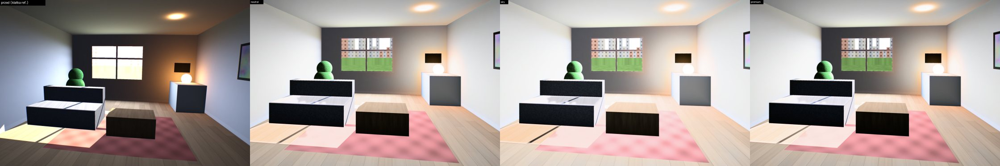
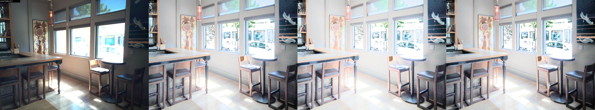

# EstateHDR — automatyczna obróbka zdjęć nieruchomości

EstateHDR to działający lokalnie odpowiednik usług typu AutoHDR. Z serii bracketingowych (3–7 klatek
RAW/JPEG/TIFF) albo pojedynczych zdjęć robi gotowe do ogłoszenia zdjęcia wnętrz i budynków:
- naturalny merge HDR i widok za oknami (window pull);
- neutralną biel ścian przy mieszanym świetle;
- proste piony, bez dystorsji, winiety i aberracji;
- odszumianie i delikatne wyostrzenie;
- eksport sRGB JPEG w kilku rozmiarach (pełny + MLS 2048) z profilem ICC i EXIF.

Moduły opcjonalne: wymiana nieba, wirtualny zmierzch (twilight), usuwanie drobnych obiektów i zieleńsza trawa.
Interfejsy: wiersz poleceń (CLI) i lokalny interfejs webowy po polsku.

Jak powstał (analiza AutoHDR metodą skilla *reverse-engineer-anything*, wyłącznie na materiałach publicznych i
jako black-box): [REVERSE.md](REVERSE.md). Specyfikacja i kryteria akceptacji: [SPEC.md](SPEC.md). Założenia:
[DECISIONS.md](DECISIONS.md). Licencje: [LICENSES.md](LICENSES.md).

---

## 1. Instalacja i uruchomienie jedną komendą

Wymagania: Python ≥ 3.10 (testowany 3.13), Linux / macOS / Windows, ok. 3 GB RAM na serię 24–60 Mpx.
GPU jest opcjonalne.

```bash
cd estatehdr
./estatehdr.sh process /ścieżka/do/sesji        # obróbka folderu -> /ścieżka/do/sesji/estatehdr_output/
./estatehdr.sh web                              # interfejs: http://127.0.0.1:8765
./estatehdr.sh test                             # testy automatyczne
```

Przy pierwszym uruchomieniu skrypt tworzy `.venv` i instaluje [requirements.txt](requirements.txt). Na Windows
służy do tego `estatehdr.bat` z tymi samymi poleceniami. Bez skryptu:
`pip install -r requirements.txt && python -m estatehdr process <folder>`.

Wyniki dla każdej serii trafiają do folderu wyjściowego:
- `<seria>_full.jpg`: wymiary jak wejście;
- `<seria>_mls.jpg`: dłuższy bok 2048 px;
- `report.json`: parametry, ostrzeżenia, czasy i pamięć. Zapisywany po każdej serii (`"complete": false` i lista
  `pending`), a na końcu z `"complete": true`. Lista `skipped` pokazuje pliki pominięte celowo (np. JPEG obok
  RAW, poprzednie wyniki EstateHDR), a `unreadable` pliki nieczytelne;
- `groups.json`: grupowanie, do ręcznej korekty (ścieżki względem folderu sesji);
- `estatehdr.log`;
- `.previews/`: podglądy przed/po dla UI.

## 2. Wiersz poleceń

```bash
./estatehdr.sh process SESJA [-o WYJŚCIE] [--preset neutral|airy|premium]
      [--sky [clear|wispy|dramatic|PLIK|KATALOG]] [--twilight [blue|pink|golden]]
      [--remove] [--grass] [--no-verticals] [--no-windows] [--mls-size 2048]
      [--single] [--bracket-size N] [--groups groups.json] [--workers N]
      [--config moj.yaml] [--set klucz.podklucz=wartość ...] [-v]
./estatehdr.sh group SESJA -o groups.json    # samo grupowanie (do ręcznej poprawki)
./estatehdr.sh presets                       # lista presetów
```

Przykłady:

```bash
./estatehdr.sh process ~/sesje/ul_Polna_12 --preset airy
./estatehdr.sh process ~/sesje/dom --sky wispy --grass                 # exteriory z nowym niebem
./estatehdr.sh process ~/sesje/dom --twilight pink                     # wirtualny zmierzch
./estatehdr.sh process ~/sesje/salon --remove        # usuwa obiekty z masek IMG_0012.mask.png (białe = usuń)
./estatehdr.sh group ~/sesje/x -o g.json  &&  (popraw g.json)  &&  ./estatehdr.sh process ~/sesje/x --groups g.json
./estatehdr.sh process ~/zdjecia_z_telefonu --single                   # każde zdjęcie osobno (pseudo-HDR)
./estatehdr.sh process ~/sesje/x --set tonemap.target_key=0.6 --set white_balance.target_cct=6300
```

Batch nigdy się nie zatrzymuje na pojedynczym problemie:
- uszkodzony plik trafia do `unreadable` i nie jest dołączany do serii (z serii odpada tylko nieczytelna klatka);
- niepełna seria albo brak EXIF dają ostrzeżenie tej serii;
- awaria procesu roboczego (np. brak pamięci) dotyczy tylko serii, która ją wywołała. Pozostałe serie są
  przeliczane ponownie, pojedynczo.

Kody wyjścia:
- **0**: wszystko w porządku;
- **1**: w folderze nie ma obsługiwanych zdjęć;
- **2**: nie ma takiego folderu, błędna opcja (`--preset`, `--config`, `--set`, `--groups`; jednolinijkowy komunikat
  `błąd: ...`), któraś seria się nie udała albo któryś plik był nieczytelny.

Ostatnia linia na wyjściu to JSON z liczbami `ok`, `failed` (serie z błędem + nieczytelne pliki), `failed_series` i
`unreadable`. Szczegóły i błędy są też w `estatehdr.log` w folderze wyjściowym, łącznie z logami procesów roboczych.

Fotografowanie RAW+JPEG: pliki o tej samej nazwie w jednym folderze (`IMG_1.CR2` + `IMG_1.JPG`) to jedna klatka,
używany jest RAW. Serie o tej samej nazwie (np. `IMG_0001` w dwóch podfolderach) dostają przyrostek `_2`, `_3`,
więc wyniki się nie nadpisują. Folder wyjściowy wewnątrz sesji jest pomijany przy ponownym uruchomieniu.
Zdjęcia z profilem ICC innym niż sRGB (Adobe RGB, ProPhoto, Display P3) są konwertowane do sRGB (LittleCMS),
z ostrzeżeniem w raporcie.

## 3. Interfejs webowy

`./estatehdr.sh web` uruchamia serwer pod `http://127.0.0.1:8765` (tylko lokalnie). Zadania są w `work/jobs/`.
1. **Zdjęcia:** przeciągnij folder (rekurencyjnie) lub wybierz pliki, z paskiem postępu wysyłania.
2. **Serie:** automatyczne grupowanie z miniaturami i EV. Ręczna korekta: przenieś klatkę do innej lub nowej
   serii, połącz albo rozdziel serie, zmień nazwę. Przycisk „Maska usuwania” otwiera pędzel na klatce
   referencyjnej.
3. **Ustawienia:** preset (neutral / airy / premium), piony, okna, niebo, zmierzch, trawa, usuwanie obiektów,
   rozmiar MLS.
4. **Kolejka i wyniki:** postęp każdej serii z nazwą etapu, suwak przed/po, pobieranie pojedynczych plików
   oraz ZIP (MLS / pełne / wszystko). Zadania przetrwają restart serwera.

Zrzuty: [reports/ui/](reports/ui/).

## 4. Jak to działa (pipeline)

| Etap | Moduł | Co robi |
|---|---|---|
| Grupowanie | `grouping.py` | Reguły per para klatek: aparat, rozmiar, ogniskowa, odstęp czasu, powtórzona ekspozycja z EXIF. Bez EXIF: skok jasności ≥ 0.4 EV i podobieństwo kadru. Ręczna korekta przez `groups.json` lub UI |
| Linearyzacja | `series.py`, `io/` | RAW (LibRaw, DHT/FBDD, mapy cieniowania obiektywu GainMap z DNG), TIFF16 (liniowy vs sRGB rozstrzygany zgodnością z EXIF), JPEG (dopasowanie krzywej odpowiedzi kamery), konwersja profili ICC innych niż sRGB. Ekspozycje z EXIF, weryfikowane pikselami |
| Wyrównanie | `align.py` | SIFT + RANSAC, ECC, dokładny etap ECC w wyższej rozdzielczości, walidacja względem identyczności |
| Merge HDR | `merge.py` | Radiancja liniowa ze wszystkich klatek (wagi SNR), wykrywanie duchów względem klatki referencyjnej, neutralizacja kolorowej czerni RAW. Praca w pasach |
| Obiektyw | `lens.py` | Aberracja chromatyczna (skala radialna R/B), winieta (symetria gradientów radialnych ze strażnikami przeciw cieniowaniu sceny, albo ręcznie) |
| Scena nocna | `pipeline.py` | Wykrywa nocny exterior (ciemne, gładkie niebo u góry kadru) i wtedy: bez window pull, niski klucz tonalny, noc zostaje nocą |
| Okna | `windows.py` | Fizyczna detekcja obszarów poza zakresem wnętrza i klasyfikacja (okno / lampa / plama słońca / niebo) |
| Balans bieli | `color.py` | Globalny (szare kandydatury → locus Plancka, cel 7400 K przy sile 0.5, czyli biel w połowie drogi; D-32) + lokalne pole mieszanego światła + osobna korekta widoków |
| Tonemapping | `tonemap.py` | Lokalna kompresja (filtr prowadzony, bez halo), window pull rozwiązywany na krzywej, globalna krzywa PCHIP zakotwiczona na percentylach wnętrza (z limitem rozciągnięcia czerni dla scen o małym kontraście), próg szumu w logarytmie luminancji, kolor z zachowaniem nasycenia, miękkie wygaszanie świateł |
| Odszumianie | `denoise.py` | Funkcja poziomu szumu σ(jasność) (Immerkaer w przedziałach jasności), filtr prowadzony luminancji i chrominancji, dla silnego szumu NLM po stabilizacji wariancji. Pojedynczy RAW: słabsze podnoszenie cieni przy głośnych cieniach (D-39) |
| Moduły | `modules/` | Niebo, zmierzch, usuwanie obiektów (exemplar-based) i trawa, przed geometrią |
| Geometria | `geometry.py` | Dystorsja metodą plumb-line, piony z punktu zbiegu (LSD + RANSAC), obrót kamery, crop ≤ 15%, powrót do wymiarów wejścia. Szacowana przed modułami, stosowana po nich (D-42) |
| Eksport | `export.py`, `io/writer.py` | Wyostrzanie z progiem szumu, dithering, sRGB ICC, EXIF z klatki referencyjnej, rozmiary |

Wymagający obliczeniowo kod pełnej rozdzielczości działa w pasach wierszy. Batch używa puli procesów, a liczba
workerów wynika z budżetu RAM.

## 5. Presety i parametry

| Preset | Charakter | Najważniejsze różnice (wartości po kalibracji, D-32, D-37) |
|---|---|---|
| `neutral` (domyślny) | naturalny, jasny wygląd do ogłoszeń (MLS) | klucz tonalny 0.70, kompresja cieni 0.64, widok za oknem ≈ 0.6, biel neutralna przy mieszanym świetle |
| `airy` | jasny, lekki (high-key) | klucz 0.85, łagodniejsza kompresja lokalna (0.78), jaśniejszy widok za oknem, mniej kontrastu i nasycenia |
| `premium` | „magazynowy” | ten sam klucz co neutral, ale słabiej podniesione cienie (0.86), więcej kontrastu, wibracji i detalu, ciemniejszy nasycony widok za oknem |

Presety są skalibrowane każdy do swojego pasma jasności ścian ze SPEC (neutral L* 78–88, airy 84–92, premium
74–86), z ograniczeniem kolejności: premium nie jest jaśniejszy od neutral, a neutral od airy.

Wszystkie parametry są w jednym pliku [config.yaml](config.yaml), z komentarzami po polsku. Kolejność (późniejsze
wygrywa): `config.yaml` → ustawienia wybranego presetu → własny plik `--config` → `--set klucz=wartość`.
Z własnego pliku liczą się tylko wartości **różne od domyślnych**: można skopiować cały `config.yaml`, zmienić kilka
liczb, a presety dalej działają. Własny plik może też zmienić same presety (sekcja `presets`). Przełączniki
`auto | off` akceptują też `false`. Najczęściej używane:

| Klucz | Znaczenie |
|---|---|
| `tonemap.target_key` / `target_white` / `black_target` | jasność średnich tonów, bieli i czerni (wartości sRGB) |
| `tonemap.compress_shadows` / `compress_highlights` | siła lokalnej kompresji (1 = brak) |
| `windows.exterior_target`, `windows.strength` | jasność widoku za oknem i siła jego pullu |
| `white_balance.target_cct`, `global_strength`, `mixed_light_strength` | docelowa temperatura bieli, siła korekty globalnej i lokalnej |
| `geometry.verticals`, `max_crop`, `min_k1` | korekcja pionów, maksymalny crop, próg korekcji dystorsji |
| `denoise.luma` / `chroma`, `sharpen.amount` | odszumianie i wyostrzanie |
| `export.sizes` | rozmiary wyjściowe (nazwa, dłuższy bok, jakość JPEG) |
| `runtime.workers`, `memory_limit_gb`, `device` | równoległość, budżet pamięci, GPU (`auto` / `gpu` / `cpu`) |
| `modules.*` | moduły opcjonalne i ich parametry |

**GPU:** przy `runtime.device: auto` ciężkie operacje OpenCV idą przez OpenCL (OpenCV T-API, `cv2.UMat`), jeśli
w systemie jest sterownik OpenCL dla dowolnej karty. Dotyczy to remapu geometrii, warpów merge, filtrów prowadzonych,
rozmyć i NLM. Bez OpenCL działa CPU. Ścieżka UMat jest testowana na zgodność wyników (`tests/test_accel.py`), ale
w środowisku, w którym powstał projekt, nie było GPU, więc **przyspieszenia na GPU nie zmierzyłem**.

## 6. Jakość: pomiary

Wszystkie liczby pochodzą z uruchomień w tym repozytorium (4 rdzenie CPU, bez GPU), na finalnej konfiguracji.
Pełne tabele i obrazy są w [reports/](reports/). Dane testowe opisuje §7.

### 6.1 Kalibracja: przed i po (pełny pipeline, sceny syntetyczne z GT)

Ten sam kod, różnią się tylko parametry: przed = [config_before_full.yaml](reports/calibration/config_before_full.yaml),
po = `config.yaml`. Średnie z 3 wnętrz z prawdą referencyjną (6 serii dla metryk bez GT). Pełna tabela per seria:
[reports/calibration/full_pipeline.md](reports/calibration/full_pipeline.md).

| Metryka (cel ze SPEC) | neutral przed → po | airy przed → po | premium przed → po |
|---|---|---|---|
| Neutralność ścian ΔE2000, GT (≤ 3.0) | 5.57 → **3.09** | 5.55 → **3.07** | 5.60 → **3.16** |
| Jasność ścian L*, GT (neutral 78–88, airy 84–92, premium 74–86) | 62.6 → **75.6** | 67.7 → **87.1** | 61.1 → **76.1** |
| Jasność widoku za oknem L* (55–80, premium 45–70) | 75.0 → 71.5 | 79.7 → 76.3 | 71.3 → 66.3 |
| Odzyskiwalne przepalenia okna, % (< 5) | 0.0 → 0.0 | 0.0 → 0.0 | 0.0 → 0.0 |
| Przepalenia poza źródłami światła, %, GT (< 0.5) | 0.03 → 0.03 | 0.02 → 0.03 | 0.04 → 0.04 |
| Zaczernienia, % (< 0.5) | 0.00 → 0.00 | 0.00 → 0.00 | 0.02 → 0.02 |
| Halo przy oknie ΔL* (< 4) | −0.6 → −0.8 | −0.9 → −0.4 | −0.7 → −0.4 |
| Pionowość, mediana [°] (≤ 0.5) | 0.08 → 0.06 | 0.06 → 0.07 | 0.07 → 0.09 |
| Detal widoku okna / GT (≥ 0.6) | 1.06 → 1.03 | 0.94 → 1.11 | 1.22 → 1.21 |
| MS-SSIM do „idealnej edycji” GT | 0.93 → 0.90 | 0.93 → 0.86 | 0.93 → 0.90 |
| ΔE2000 do „idealnej edycji” GT | 10.2 → 13.9 | 11.6 → 19.1 | 10.1 → 13.7 |

Kalibracja poprawia cele ze SPEC (neutralność i jasność ścian). Zgodność z „idealną edycją” spada, bo w danych
syntetycznych ma ona ściany L* 46–54, a cele SPEC wymagają jasnych, białych ścian (D-32).
Funkcja celu (`neutral`): 8.78 → 4.77 → 2.99. Przebiegi: [reports/calibration/](reports/calibration/).

**Walidacja na danych nieużytych w kalibracji** (preset `neutral`, przed → po):

| Zbiór | Mediana jasności | ΔE jasnych powierzchni (auto) | Przepalenia poza nieodzyskiwalnymi, % |
|---|---|---|---|
| HDR+ (6 serii z prawdziwą treścią wnętrz) | 0.58 → 0.71 | 6.70 → **5.96** | 0.58 → 0.61 |
| OpenCV: Memorial Church (Debevec) i St. Louis (noc) | 0.43 → 0.50 | 7.16 → 7.41 | 1.38 → 2.01 |
| Portfolio: 21 gotowych zdjęć (tryb jednej klatki), zmiana względem wejścia | — | ΔE do wejścia 4.60 → 4.57* | 0.40 → 0.43 |

\* Po zmianie zakresu klucza w trybie jednej klatki (D-32). Bez tej zmiany ΔE wynosiło 6.74.

### 6.2 Porównania przed i po dla każdego presetu

[reports/comparisons/README.md](reports/comparisons/README.md) zawiera 18 zestawień (klatka referencyjna | neutral |
airy | premium) i tabele metryk dla każdej serii. Średnie:

| Zbiór | Preset | Mediana jasności | Przepalenia*, % | Neutralność ΔE (auto) | Ściany L* (GT) | Widok L* (GT) |
|---|---|---|---|---|---|---|
| syntetyczne (6 serii) | neutral / airy / premium | 0.69 / 0.82 / 0.69 | 1.16 / 1.14 / 1.17 | 3.89 / 3.81 / 3.91 | 75.6 / 87.1 / 76.1 | 71.5 / 76.3 / 66.3 |
| HDR+ (6 serii) | neutral / airy / premium | 0.71 / 0.84 / 0.71 | 0.61 / 0.67 / 0.70 | 5.96 / 5.29 / 6.06 | — | — |
| OpenCV (2 serie) | neutral / airy / premium | 0.50 / 0.58 / 0.50 | 2.01 / 2.74 / 2.19 | 7.41 / 7.29 / 7.48 | — | — |
| portfolio (3 zdjęcia) | neutral / airy / premium | 0.69 / 0.70 / 0.70 | 0.57 / 0.56 / 0.66 | 2.49 / 2.30 / 2.64 | — | — |

\* Piksele ≥ 254/255 poza obszarami przepalonymi w każdej klatce, łącznie z lampami i oknami.




### 6.3 Etapy pipeline'u względem prawdy referencyjnej

Pomiary z [tools/verify_hypotheses.py](tools/verify_hypotheses.py) ([reports/verification.json](reports/verification.json)),
sceny syntetyczne 2400×1600:

| Etap (kryterium SPEC) | Wynik |
|---|---|
| Grupowanie (100% z EXIF i bez) | 6/6 serii dokładnie z EXIF i 6/6 bez EXIF. Uszkodzony plik trafia do `unreadable` |
| Wyrównanie (≤ 0.6 px statyw, ≤ 0.8 px z ręki) | średni błąd 0.22–0.45 px (z ręki, przesunięcia do 10 px) |
| Merge (3 z N) | mediana błędu log2 radiancji: wszystkie klatki 0.008–0.010, 3 skrajne 0.014–0.018 |
| Okna (< 5% odzyskiwalnych przepaleń, L* 55–80, detal ≥ 0.6×) | odzyskiwalne przepalenia 0%, L* widoku 70.6–71.9, detal 0.98–1.12× GT, halo −3.1…+0.7 L*. Okna przepalone już w najciemniejszej klatce (13% i 43% powierzchni) zostają białe |
| Geometria (piony ≤ 0.5°, \|k1 − k1_GT\| ≤ 0.02) | k1 0.060 / 0.040 / 0.069 przy prawdzie 0.06 / 0.04 / 0.08; korekta pochylenia z błędem 0.07–0.60°, przechyłu ≤ 0.1°; mediana odchylenia pionów po korekcie 0.04–0.14°; crop 2.3–3.2% |
| Aberracja chromatyczna (resztkowa ≤ 0.3 px) | prawda: R +0.12%, B −0.12%. Dane liniowe (TIFF 16-bit, radiancja GT): oszacowanie R +0.09…+0.11%, czyli 75–90% korekty. Serie JPEG: +0.04…+0.05%, bo subsampling 4:2:0 rozmywa przesunięcie kolorów już w pliku (ten sam obraz jako 4:4:4 daje +0.075%, jako 4:2:0 +0.045%). Resztkowe CA na brzegu ok. 0.4 px (dane liniowe) i ok. 1 px (JPEG 4:2:0), więc **kryterium SPEC nie jest spełnione** |
| Odszumianie (σ niższe niż w klatce) | 6 zaszumionych pojedynczych RAW z HDR+: σ niższe we wszystkich 6, o 3–33%. Mniej niż przed kalibracją (20–35%), bo jaśniejszy klucz tonalny uwidacznia szum cieni |
| Niebo (IoU ≥ 0.85) | IoU 0.936 (syntetyczny exterior); 12/14 exteriorów HDR+ wykrytych, 1 fałszywe na 104 wnętrzach |

### 6.4 Moduły opcjonalne

| Moduł | Pomiar |
|---|---|
| Usuwanie obiektów | 26 obrazów z dziurą o znanej treści: ΔE2000 do oryginału 1.12 (exemplar) vs 1.43 (Telea) na jednorodnym tle, 5.07 vs 6.50 przy losowym położeniu. Poza maską piksele bez zmian (test) |
| Wymiana nieba | patrz 6.3; zdjęcie nieba użytkownika komponowane w pełnej rozdzielczości (test) |
| Twilight | deterministyczny relighting; test: niebo w stylu, świecące okna, fasada ciemniejsza |
| Trawa | test: trawnik zieleńszy, kolory poza trawnikiem bez zmian |

### 6.5 Test „nie psuć” (tryb jednej klatki, 104 gotowe zdjęcia z portfolio)

104/104 bez błędu. Wynik względem wejścia: SSIM mediana **0.967** (p10 0.914), MS-SSIM 0.948, ΔE2000 mediana
**4.57** (p90 6.35), pionowość 0.19° (mediana). Cel SPEC: SSIM ≥ 0.85, ΔE ≤ 6 (średnia 4.90).
Plik: [reports/portfolio_do_no_harm.json](reports/portfolio_do_no_harm.json).

### 6.6 Wydajność i pamięć

| Seria | Czas | Szczyt RAM | Najdłuższe etapy |
|---|---|---|---|
| 3 × 24 Mpx (6000×4000) | 79 s | 2.25 GB | tone mapping, merge, wyrównanie |
| 3 × 60 Mpx (9504×6336) | 137 s | 2.71 GB | tone mapping 42 s, merge 35 s, wyrównanie 22 s, geometria 18 s |

Cel SPEC: ≤ 6 GB na workera. Szczegóły: [reports/perf.json](reports/perf.json). 104 zdjęcia portfolio (2 workery):
502 s.

### 6.7 Kryteria akceptacji ze SPEC: podsumowanie

**Spełnione:**
- grupowanie 100% z EXIF i bez EXIF;
- wyrównanie;
- duchy;
- przepalenia i zaczernienia poza światłami;
- halo;
- odzyskiwalne przepalenia okien i jasność widoku;
- detal okien;
- piony i dystorsja;
- szum niższy niż w klatce;
- test „nie psuć” (SSIM ≥ 0.85, ΔE ≤ 6);
- maska nieba (IoU ≥ 0.85);
- eksport (sRGB ICC, EXIF, wymiary);
- pamięć ≤ 6 GB na 60 Mpx;
- jasność ścian dla airy i premium.

**Niespełnione albo na granicy:**
- neutralność ścian ΔE 3.07–3.16 przy celu ≤ 3.0 (≤ 5 przy żarówkach jest spełnione);
- jasność ścian w `neutral` L* 75.6 przy celu 78–88. Klucz tonalny jest celowo ograniczony do 0.70, bo
  jaśniejszy wyglądał na prawdziwych zdjęciach na wyprany (D-32);
- resztkowa aberracja chromatyczna 0.4–1 px przy celu ≤ 0.3 px (6.3).

### 6.8 Testy automatyczne

`./estatehdr.sh test`: **82 testy**, wszystkie przechodzą (ok. 100 s). Pokrycie:
- wejście i EXIF, profile ICC, uszkodzone pliki;
- grupowanie;
- ekspozycje i krzywa odpowiedzi, wyrównanie względem GT, merge i duchy;
- okna, WB, tone mapping, odszumianie, CA, winieta, dystorsja, piony, tryb nocny;
- moduły;
- batch: izolacja błędów i awarii workera, równoległość;
- eksport (ICC, EXIF, rozmiary), CLI, web UI, ścieżka GPU (UMat) zgodna z CPU.

## 7. Kalibracja

Nie było par referencyjnych (zdjęcie wejściowe + wynik AutoHDR), więc parametry dostroiłem do mierzalnych celów
z opisu produktu (SPEC.md, REVERSE.md §5) na scenach syntetycznych z prawdą referencyjną:
- neutralność bieli;
- jasność ścian i widoku za oknem;
- przepalenia;
- halo;
- ΔE i SSIM do „idealnej edycji” jako regularyzator.

```bash
python tools/calibrate.py --input data/synthetic/input --synthetic-gt data/synthetic --preset neutral \
    --out reports/calibration/moj_przebieg
python tools/calibrate.py --input data/synthetic/input --synthetic-gt data/synthetic --preset airy \
    --params tonemap.target_key,tonemap.compress_shadows,tonemap.compress_highlights,windows.exterior_target \
    --bound tonemap.target_key=0.5:0.85 --out reports/calibration/moj_airy   # tylko parametry tonu, własne granice
python tools/calibrate.py --input SESJE --pairs WYNIKI_AUTOHDR --out reports/calibration/pary   # pary 1:1
python tools/compare_configs.py --input data/synthetic/input --synthetic-gt data/synthetic \
    --before reports/calibration/config_before_full.yaml --preset neutral,airy,premium \
    --out reports/calibration/full_pipeline.md                 # pełny pipeline przed / po kalibracji
```

Wynik trafia do `reports/calibration/`:
- `calibrated.yaml` (do użycia z `--config`; dla airy/premium wartości trafiają do sekcji `presets`);
- `calibration.md` (tabela przed/po) i `calibration.json` (przebieg).

Przebiegi: `calibration.md` (neutral, przebieg 2), `continuation/` (neutral, przebieg 3), `preset_airy/`,
`preset_premium/` (pierwszy przebieg, odrzucony, bo dał premium jaśniejszy od neutral) i
`preset_premium_bounded/` (przyjęty). Ocena jakości dowolnego folderu wyjściowego:
`python tools/evaluate.py WYJŚCIE [--synthetic-gt data/synthetic] [--pairs WYNIKI_AUTOHDR]`.
Liczy histogram, % przepaleń i zaczernień, pionowość linii (°), neutralność ścian (ΔE), jasność i detal okien,
halo, szum i ostrość, a przy parach także SSIM, MS-SSIM, gradient-SSIM, ΔE2000 i LPIPS (jeśli zainstalowany).

Dane testowe: `python tools/make_synthetic.py` (sceny z GT) i `python tools/fetch_public_data.py` (HDR+, OpenCV,
portfolio). Porównania presetów: `python tools/make_comparisons.py`. Weryfikacja hipotez z REVERSE.md:
`python tools/verify_hypotheses.py`.

## 8. Założenia

Pełna lista z uzasadnieniami jest w [DECISIONS.md](DECISIONS.md). Najważniejsze:
- Brak par referencyjnych, więc kalibracja jest prowadzona do opisów, GT syntetycznego i testu „nie psuć” na
  gotowych zdjęciach.
- Merge w liniowej radiancji ze wszystkich klatek zamiast uczonej fuzji 3 klatek. Bez danych treningowych jest to
  podejście mierzalne i jawne.
- Wynik `full` ma wymiary wejścia (jak w AutoHDR), a obok powstaje wersja MLS 2048 px.
- Bez modeli neuronowych. Wszystko jest algorytmiczne, więc licencje są czyste, a działanie offline.

## 9. Znane ograniczenia

Uczciwie, z pomiarami (szczegóły w `reports/`):

1. **Bez modeli AI.** Wszystkie etapy są algorytmiczne. Tam, gdzie AutoHDR ma modele uczone na ponad 1 mln par,
   EstateHDR jest słabszy:
   - **Twilight** to deterministyczny relighting: niebo zmierzchu, przyciemnienie i ochłodzenie fasady, świecące
     szyby. Wygląda wiarygodnie na prostych fasadach. Okna wykrywa jednak jako ciemne prostokąty, więc czasem
     „zapala” ciemny cień (np. pod schodami) albo pomija okno odbijające niebo. Nie generuje nowych źródeł światła
     (latarnie, oświetlenie ogrodu).
   - **Usuwanie obiektów wymaga maski** (pędzel w UI lub `<nazwa>.mask.png`); nie ma automatycznego wykrywania
     bałaganu. Inpainting exemplar-based dobrze wypełnia jednorodne powierzchnie i faktury (ściana, podłoga,
     trawa, liście): ΔE 1.12 do oryginału przy dziurach na jednorodnym tle, wobec 1.43 dla Telea. Duże dziury na
     styku kilku struktur mogą jednak przedłużyć linię albo krawędź tam, gdzie nie powinna być (np. fuga deski o
     jedną deskę za daleko).
   - **Wymiana nieba:** detekcja opiera się na regułach (rozrost od gładkich nasion u góry kadru i walidacja
     kolor/jasność). Na 14 exteriorach z HDR+ niebo wykryte w 12. Nie wykrywa nieba na zachodzie słońca z silnie
     teksturowanymi chmurami. Chmury o mocnej teksturze, które leżą tuż nad dachem, mogą zostać w obrazie obok nowego
     nieba. W prześwitach koron drzew zdarzają się drobne jasne plamki starego nieba. Na 104 wnętrzach jedna
     fałszywa detekcja (prześwietlone okno u góry kadru).
2. **Okna przepalone w najciemniejszej klatce** są renderowane jako czysta biel z miękką krawędzią. Danych nie
   da się odzyskać (pomiar: przepalone w wyniku = przepalone w ciemnej klatce, a odzyskiwalne przepalenia 0%).
   AutoHDR w takiej sytuacji może „dorysować” widok, my nie.
3. **Balans bieli:**
   - bardzo silne dominanty (np. 3000 K przy WB „dzień”) są korygowane tylko częściowo, przez celowy miękki limit,
     który chroni wnętrza pełne drewna przed zsinieniem. Od ok. 4000 K korekta jest pełna;
   - neutralność ścian w scenach mieszanego światła (żarówki + okno): ΔE 3.1 przy celu SPEC ≤ 3.0 (≤ 5 w strefie
     żarówek jest spełnione);
   - na starych zdjęciach o nieznanej krzywej odpowiedzi (OpenCV Memorial Church) zostaje różowa dominanta na
     drewnie i kolorowy szum w ciemnych narożnikach. Neutralność ΔE 7.4, czyli gorzej niż przed kalibracją (7.2).
4. **Tryb jednej klatki (pseudo-HDR)** nie ma informacji spoza zakresu jednego zdjęcia. Przepalone okna zostają
   białe, a szum cieni ograniczamy, więc cienie są podnoszone ostrożniej. Dla już wywołanych JPEG-ów pipeline
   świadomie „nie przerabia” zdjęcia: na 104 gotowych zdjęciach portfolio SSIM ma medianę 0.967, a ΔE 4.57.
5. **GPU** działa przez OpenCL (OpenCV T-API) tylko dla części operacji. Ścieżka jest testowana na zgodność
   wyników na CPU, ale przyspieszenie na prawdziwym GPU nie zostało zmierzone (brak GPU w środowisku).
6. **Kalibracja bez par.** Nie było par „wejście → wynik AutoHDR”, więc presety są dostrojone do celów ze SPEC
   (opis wyglądu AutoHDR) na 3 scenach syntetycznych z GT i sprawdzone na danych odłożonych (HDR+, OpenCV,
   portfolio). Nie są dopasowane 1:1 do AutoHDR, a kilka parametrów skończyło na granicach przedziałów (D-32).
   Jasność ścian w `neutral` (L* 75.6) jest celowo poniżej pasma SPEC 78–88, bo jaśniejszy klucz wyglądał na
   prawdziwych zdjęciach na wyprany. `tools/calibrate.py --pairs` jest gotowe na pary.
7. **LPIPS** nie jest liczony (brak `torch` i wag o jasnej licencji). Raport podaje SSIM, MS-SSIM, gradient-SSIM
   (zgodność krawędzi) i ΔE2000.
8. **Wydajność** (4 rdzenie CPU, bez GPU): seria 3×24 Mpx 79 s, 3×60 Mpx 137 s; szczyt pamięci
   2.25 GB i 2.71 GB. Wolniej niż usługa w chmurze, ale lokalnie i równolegle dla wielu serii.
9. **RAW**: odczyt przez LibRaw (rawpy) obejmuje praktycznie wszystkie aparaty, ale bez profili obiektywów.
   Korekcja dystorsji, winiety i CA jest estymowana z obrazu, a winieta automatycznie tylko przy spójnym
   profilu.
10. **Aberracja chromatyczna:**
    - na danych liniowych (RAW/TIFF) korekta usuwa 75–90% bocznej CA; resztka ok. 0.4 px na brzegu;
    - w JPEG-ach z subsamplingiem 4:2:0 część przesunięcia kolorów jest rozmyta już w pliku, więc korekta jest
      mniejsza (ok. 40%, resztka ok. 1 px);
    - cel SPEC ≤ 0.3 px nie jest spełniony.
11. **Miara pionowości** w raportach liczy odchylenie wszystkich długich, prawie pionowych linii. Na zdjęciach
    bez architektonicznych pionów (portret w restauracji, zbliżenie lunety, kopuła z rybiego oka) mediana wynosi
    1.5–3.3° i nie oznacza krzywych ścian. Na wnętrzach z GT wynosi 0.04–0.14°.
12. **Odszumianie** jest umiarkowane. Po kalibracji jaśniejszy klucz tonalny uwidacznia szum cieni, więc spadek
    σ szumu na pojedynczych RAW wynosi 3–33% (wcześniej 20–35%).


## 10. Następne kroki (największy zysk)

1. **Pary „wejście → wynik AutoHDR”.** Nawet 50–100 sesji pozwoli skalibrować presety 1:1:
   `tools/calibrate.py --pairs` jest gotowe i liczy ΔE2000, SSIM, MS-SSIM, a z LPIPS, jeśli jest zainstalowany.
   Dziś kalibracja opiera się na opisach i scenach syntetycznych (D-32). Możliwe źródło to publiczny zbiór konkursu
   grupowania AutoHDR, ale wyłącznie po potwierdzeniu licencji i za zgodą właściciela projektu (D-18).
2. **Modele uczone na licencjach komercyjnych** (MIT/Apache, z wagami o jasnym pochodzeniu):
   - segmentacja nieba i okien zamiast reguł (twilight, wymiana nieba, okna z firankami);
   - odszumianie pojedynczych RAW, które jest dziś najsłabszym punktem trybu jednej klatki.
3. **Profile obiektywów** dla dystorsji, winiety i CA. Estymacja z obrazu jest ostrożna (winieta we wnętrzach jest
   świadomie pomijana, D-44). Warunek: baza o licencji pozwalającej na użycie komercyjne albo własna kalibracja
   z płaskiego kadru, gdzie estymator jest dokładny.
4. **Pomiar na GPU.** Ścieżka OpenCL jest zgodna z CPU (testy), ale przyspieszenia nie zmierzyłem (brak GPU).
