# Porównania przed / po dla presetów

Wygenerowane przez `tools/make_comparisons.py` (pełny pipeline, metryki z `estatehdr/quality`).
Kolumny: klip = % pikseli z kanałem ≥ 254, klip_excl = bez obszarów przepalonych w każdej klatce, zaczernienie = % ≤ 1, pion = mediana odchylenia linii pionowych [°], ściana ΔE = neutralność bieli (CIEDE2000; _gt = maska ścian z GT), win_L = L* widoku za oknem (bez nieodzyskiwalnych pikseli), ssim/dE_ref = zgodność z idealną edycją GT.

## Przed: klatka referencyjna jak z aparatu (podgląd, te same metryki)

| seria | clipped_% | crushed_% | median_luma | vert_med_deg | wall_dE_auto |
|---|---|---|---|---|---|
| syntetyczne/IMG_0000 | 9.551 | 0.001 | 0.327 | 2.874 | 10.066 |
| syntetyczne/IMG_0005 | 15.925 | 0.080 | 0.156 | 2.408 | 8.855 |
| syntetyczne/IMG_0008 | 8.454 | 0.000 | 0.332 | 3.913 | 9.079 |
| syntetyczne/IMG_0015 | 15.645 | 0.000 | 0.505 | 1.035 | 4.970 |
| syntetyczne/IMG_0018 | 5.642 | 0.004 | 0.239 | 1.060 | 9.283 |
| syntetyczne/NOEXIF_0000 | 8.758 | 0.001 | 0.311 | 1.073 | 10.179 |
| hdrplus/HDRP_0000 | 12.362 | 0.000 | 0.332 | 1.431 | 8.598 |
| hdrplus/HDRP_0003 | 8.967 | 0.000 | 0.323 | 1.157 | 10.050 |
| hdrplus/HDRP_0006 | 3.047 | 0.000 | 0.332 | 1.281 | 8.006 |
| hdrplus/HDRP_0009 | 8.997 | 0.000 | 0.329 | 6.489 | 11.181 |
| hdrplus/HDRP_0012 | 5.388 | 0.000 | 0.330 | 3.690 | 8.533 |
| hdrplus/HDRP_0015 | 1.172 | 0.000 | 0.328 | 0.603 | 10.110 |
| opencv/memorial_0 | 1.357 | 0.000 | 0.149 | 4.768 | 13.473 |
| opencv/stlouis_1 | 16.197 | 0.000 | 0.459 | 2.250 | 11.816 |
| portfolio_single/01.BtS2Hkmp | 0.008 | 0.071 | 0.707 | 0.323 | 5.786 |
| portfolio_single/k007.C8MVnAJ9 | 0.110 | 0.012 | 0.689 | 0.197 | 4.348 |
| portfolio_single/k040.wqWqsOuE | 0.095 | 0.013 | 0.650 | 0.232 | 3.401 |

## Po: preset `neutral`

| seria | clipped_% | clipped_excl_% | crushed_% | median_luma | vert_med_deg | wall_dE_auto | wall_dE_gt | wall_L_gt | win_L | win_clip_% | win_clip_recov_% | win_detail | halo_dL | ssim | ms_ssim | dE_ref |
|---|---|---|---|---|---|---|---|---|---|---|---|---|---|---|---|---|
| syntetyczne/IMG_0000 | 0.736 | 0.060 | 0.004 | 0.718 | 0.104 | 3.456 | 3.144 | 79.099 | 72.050 | 11.993 | 0.000 | — | 0.713 | 0.891 | 0.919 | 14.192 |
| syntetyczne/IMG_0005 | 6.034 | 0.000 | 0.009 | 0.713 | 0.056 | 3.578 | 3.191 | 69.417 | 72.082 | 41.979 | 0.000 | — | -0.137 | 0.907 | 0.909 | 10.402 |
| syntetyczne/IMG_0008 | 0.553 | 0.007 | 0.002 | 0.716 | 0.175 | 3.788 | 2.856 | 78.388 | 70.692 | 0.000 | 0.000 | — | -3.270 | 0.869 | 0.883 | 17.018 |
| syntetyczne/IMG_0015 | 3.476 | 0.000 | 0.000 | 0.707 | 0.027 | 0.966 | — | — | — | — | — | — | — | — | — | — |
| syntetyczne/IMG_0018 | 2.300 | 2.300 | 0.001 | 0.562 | 0.147 | 7.778 | — | — | 72.885 | 44.246 | — | 0.066 | — | — | — | — |
| syntetyczne/NOEXIF_0000 | 2.089 | 0.106 | 0.002 | 0.709 | 0.075 | 3.807 | — | — | 72.239 | 39.752 | — | 0.126 | — | — | — | — |
| hdrplus/HDRP_0000 | 8.208 | 0.466 | 0.002 | 0.734 | 0.289 | 4.809 | — | — | 79.452 | 60.772 | — | 0.172 | — | — | — | — |
| hdrplus/HDRP_0003 | 9.061 | 1.725 | 0.008 | 0.710 | 0.107 | 8.601 | — | — | 84.972 | 69.235 | — | 0.078 | — | — | — | — |
| hdrplus/HDRP_0006 | 0.293 | 0.293 | 0.001 | 0.707 | 0.283 | 4.860 | — | — | 70.718 | 0.000 | — | 0.202 | — | — | — | — |
| hdrplus/HDRP_0009 | 0.658 | 0.462 | 0.000 | 0.701 | 7.062 | 5.937 | — | — | 71.356 | 1.183 | — | 0.163 | — | — | — | — |
| hdrplus/HDRP_0012 | 0.501 | 0.179 | 0.000 | 0.715 | 1.665 | 6.625 | — | — | 72.951 | 4.703 | — | 0.137 | — | — | — | — |
| hdrplus/HDRP_0015 | 0.595 | 0.220 | 0.000 | 0.702 | 0.252 | 5.360 | — | — | 85.090 | 49.574 | — | 0.231 | — | — | — | — |
| opencv/memorial_0 | 3.657 | 3.401 | 0.077 | 0.702 | 5.146 | 7.701 | — | — | 61.049 | 5.403 | — | 1.251 | — | — | — | — |
| opencv/stlouis_1 | 0.586 | 0.569 | 0.026 | 0.303 | 0.737 | 7.106 | — | — | — | — | — | — | — | — | — | — |
| portfolio_single/01.BtS2Hkmp | 0.286 | 0.286 | 3.410 | 0.714 | 0.260 | 2.786 | — | — | — | — | — | — | — | — | — | — |
| portfolio_single/k007.C8MVnAJ9 | 0.361 | 0.361 | 0.241 | 0.699 | 0.143 | 1.970 | — | — | — | — | — | — | — | — | — | — |
| portfolio_single/k040.wqWqsOuE | 0.532 | 0.532 | 0.234 | 0.658 | 0.179 | 2.678 | — | — | — | — | — | — | — | — | — | — |

## Po: preset `airy`

| seria | clipped_% | clipped_excl_% | crushed_% | median_luma | vert_med_deg | wall_dE_auto | wall_dE_gt | wall_L_gt | win_L | win_clip_% | win_clip_recov_% | win_detail | halo_dL | ssim | ms_ssim | dE_ref |
|---|---|---|---|---|---|---|---|---|---|---|---|---|---|---|---|---|
| syntetyczne/IMG_0000 | 0.724 | 0.049 | 0.001 | 0.851 | 0.082 | 3.459 | 3.011 | 89.166 | 76.800 | 12.130 | 0.000 | — | 1.165 | 0.846 | 0.869 | 19.262 |
| syntetyczne/IMG_0005 | 6.021 | 0.000 | 0.003 | 0.849 | 0.045 | 3.632 | 3.138 | 83.331 | 76.780 | 42.047 | 0.000 | — | 0.437 | 0.901 | 0.879 | 13.895 |
| syntetyczne/IMG_0008 | 0.564 | 0.018 | 0.000 | 0.849 | 0.114 | 3.615 | 2.936 | 88.824 | 75.752 | 0.000 | 0.000 | — | -3.018 | 0.800 | 0.844 | 23.846 |
| syntetyczne/IMG_0015 | 3.489 | 0.000 | 0.000 | 0.844 | 0.067 | 0.952 | — | — | — | — | — | — | — | — | — | — |
| syntetyczne/IMG_0018 | 2.326 | 2.326 | 0.000 | 0.697 | 0.229 | 7.537 | — | — | 76.032 | 44.507 | — | 0.058 | — | — | — | — |
| syntetyczne/NOEXIF_0000 | 2.117 | 0.134 | 0.000 | 0.847 | 0.051 | 3.682 | — | — | 76.735 | 40.269 | — | 0.115 | — | — | — | — |
| hdrplus/HDRP_0000 | 8.253 | 0.511 | 0.001 | 0.859 | 0.300 | 4.091 | — | — | 83.136 | 62.043 | — | 0.152 | — | — | — | — |
| hdrplus/HDRP_0003 | 8.514 | 1.178 | 0.000 | 0.854 | 0.501 | 7.014 | — | — | 88.873 | 69.768 | — | 0.067 | — | — | — | — |
| hdrplus/HDRP_0006 | 0.264 | 0.264 | 0.000 | 0.844 | 0.334 | 4.243 | — | — | 75.545 | 0.000 | — | 0.232 | — | — | — | — |
| hdrplus/HDRP_0009 | 0.626 | 0.429 | 0.000 | 0.827 | 7.967 | 5.027 | — | — | 76.276 | 1.393 | — | 0.198 | — | — | — | — |
| hdrplus/HDRP_0012 | 0.431 | 0.109 | 0.000 | 0.848 | 0.746 | 5.521 | — | — | 78.250 | 4.779 | — | 0.181 | — | — | — | — |
| hdrplus/HDRP_0015 | 0.623 | 0.249 | 0.000 | 0.843 | 0.214 | 5.128 | — | — | 88.549 | 48.350 | — | 0.204 | — | — | — | — |
| opencv/memorial_0 | 4.400 | 4.144 | 0.087 | 0.843 | 2.765 | 6.913 | — | — | 64.605 | 5.209 | — | 1.382 | — | — | — | — |
| opencv/stlouis_1 | 0.584 | 0.567 | 0.003 | 0.315 | 0.641 | 6.750 | — | — | — | — | — | — | — | — | — | — |
| portfolio_single/01.BtS2Hkmp | 0.382 | 0.382 | 0.117 | 0.706 | 0.252 | 2.604 | — | — | — | — | — | — | — | — | — | — |
| portfolio_single/k007.C8MVnAJ9 | 0.406 | 0.406 | 0.034 | 0.699 | 0.136 | 1.777 | — | — | — | — | — | — | — | — | — | — |
| portfolio_single/k040.wqWqsOuE | 0.523 | 0.523 | 0.069 | 0.697 | 0.175 | 2.504 | — | — | — | — | — | — | — | — | — | — |

## Po: preset `premium`

| seria | clipped_% | clipped_excl_% | crushed_% | median_luma | vert_med_deg | wall_dE_auto | wall_dE_gt | wall_L_gt | win_L | win_clip_% | win_clip_recov_% | win_detail | halo_dL | ssim | ms_ssim | dE_ref |
|---|---|---|---|---|---|---|---|---|---|---|---|---|---|---|---|---|
| syntetyczne/IMG_0000 | 0.752 | 0.076 | 0.018 | 0.725 | 0.081 | 3.474 | 3.256 | 79.614 | 66.836 | 12.040 | 0.000 | — | 1.175 | 0.878 | 0.916 | 13.975 |
| syntetyczne/IMG_0005 | 6.061 | 0.000 | 0.037 | 0.717 | 0.050 | 3.394 | 3.225 | 69.372 | 67.127 | 41.914 | 0.000 | — | 0.421 | 0.898 | 0.905 | 10.290 |
| syntetyczne/IMG_0008 | 0.563 | 0.016 | 0.019 | 0.725 | 0.107 | 3.902 | 2.949 | 79.040 | 65.389 | 0.000 | 0.000 | — | -3.123 | 0.876 | 0.888 | 16.553 |
| syntetyczne/IMG_0015 | 3.785 | 0.181 | 0.000 | 0.713 | 0.101 | 1.110 | — | — | — | — | — | — | — | — | — | — |
| syntetyczne/IMG_0018 | 2.313 | 2.313 | 0.010 | 0.564 | 0.201 | 7.909 | — | — | 66.962 | 44.614 | — | 0.078 | — | — | — | — |
| syntetyczne/NOEXIF_0000 | 2.143 | 0.160 | 0.007 | 0.716 | 0.053 | 3.792 | — | — | 66.394 | 39.712 | — | 0.150 | — | — | — | — |
| hdrplus/HDRP_0000 | 8.273 | 0.532 | 0.018 | 0.738 | 0.343 | 4.834 | — | — | 76.090 | 60.848 | — | 0.199 | — | — | — | — |
| hdrplus/HDRP_0003 | 9.228 | 1.892 | 0.025 | 0.716 | 0.076 | 8.509 | — | — | 84.132 | 69.703 | — | 0.082 | — | — | — | — |
| hdrplus/HDRP_0006 | 0.308 | 0.308 | 0.010 | 0.711 | 0.336 | 4.853 | — | — | 65.515 | 0.000 | — | 0.218 | — | — | — | — |
| hdrplus/HDRP_0009 | 0.754 | 0.558 | 0.002 | 0.691 | 7.132 | 6.006 | — | — | 66.405 | 1.177 | — | 0.191 | — | — | — | — |
| hdrplus/HDRP_0012 | 0.548 | 0.226 | 0.001 | 0.719 | 1.682 | 6.649 | — | — | 68.807 | 4.742 | — | 0.183 | — | — | — | — |
| hdrplus/HDRP_0015 | 0.646 | 0.272 | 0.005 | 0.712 | 0.443 | 5.531 | — | — | 83.273 | 49.466 | — | 0.272 | — | — | — | — |
| opencv/memorial_0 | 3.974 | 3.718 | 0.094 | 0.709 | 8.046 | 7.767 | — | — | 58.514 | 5.481 | — | 1.328 | — | — | — | — |
| opencv/stlouis_1 | 0.640 | 0.623 | 0.060 | 0.298 | 0.555 | 7.171 | — | — | — | — | — | — | — | — | — | — |
| portfolio_single/01.BtS2Hkmp | 0.295 | 0.295 | 4.959 | 0.722 | 0.245 | 2.988 | — | — | — | — | — | — | — | — | — | — |
| portfolio_single/k007.C8MVnAJ9 | 0.507 | 0.507 | 0.353 | 0.707 | 0.134 | 2.046 | — | — | — | — | — | — | — | — | — | — |
| portfolio_single/k040.wqWqsOuE | 0.650 | 0.650 | 0.345 | 0.664 | 0.150 | 2.794 | — | — | — | — | — | — | — | — | — | — |

## Zestawienia (przed | neutral | airy | premium)

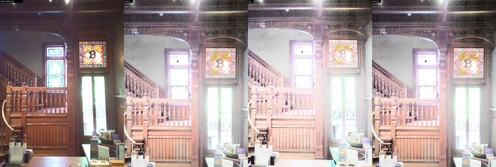
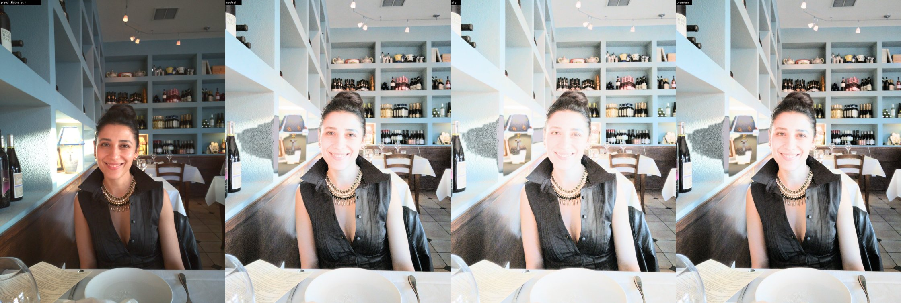
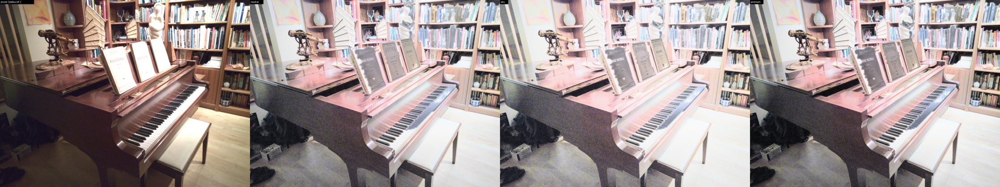
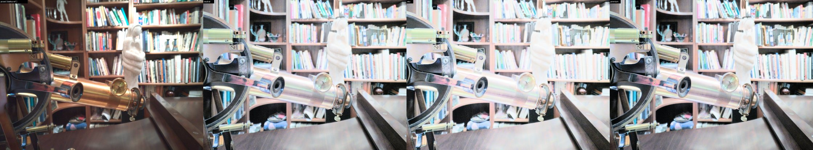
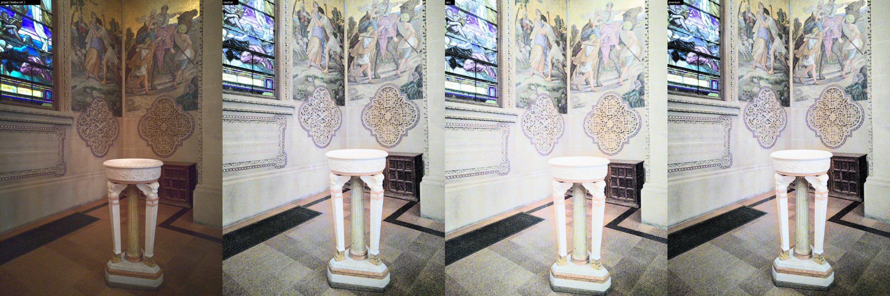
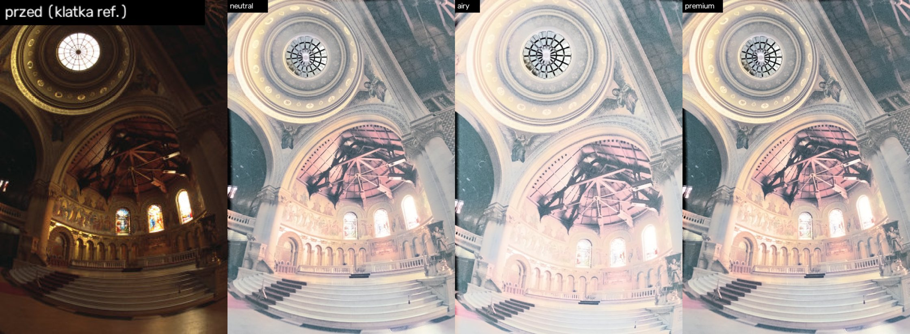
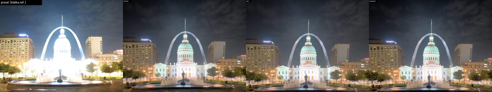
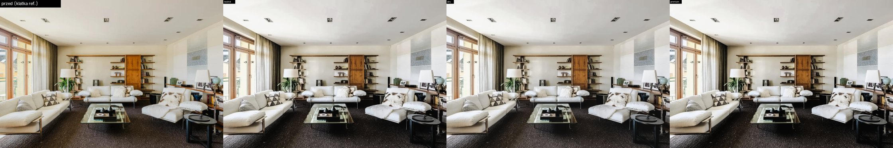
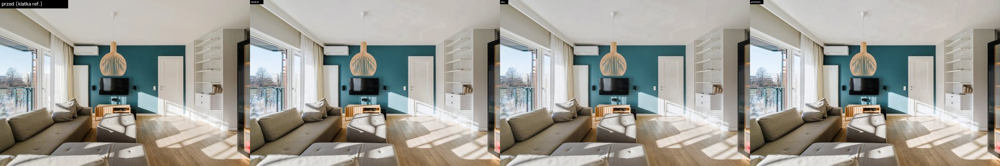
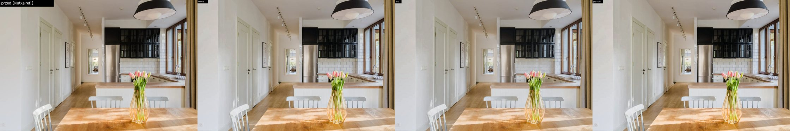

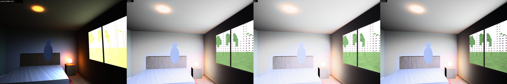
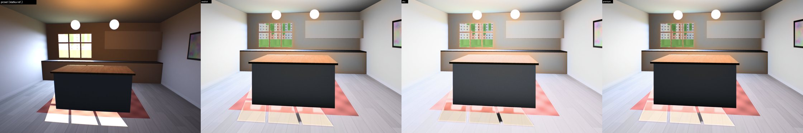
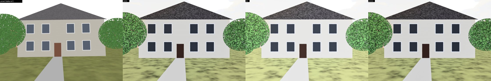
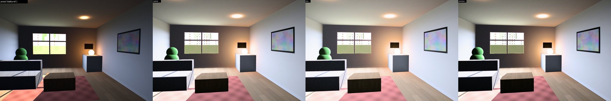
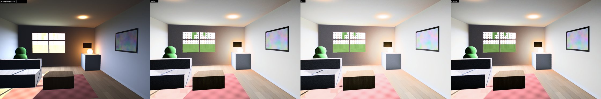
